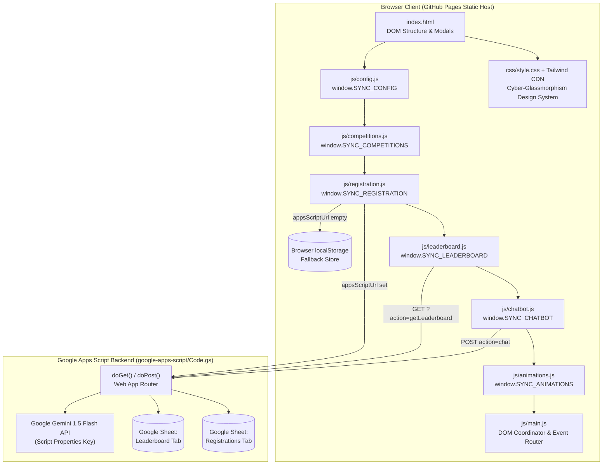
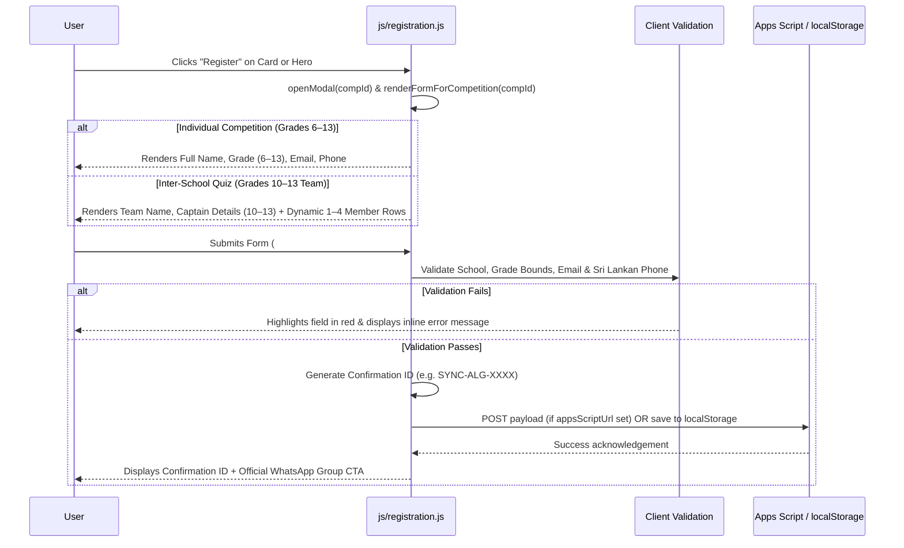

# How the SYNC ’26 Platform Works

An end-to-end architectural and operational guide to the **SYNC ’26** competition hub built for the **Dharmaraja College ICT Society**.

---

## 1. High-Level System Architecture

The application uses a **zero-build static frontend** coupled with an **optional serverless Google Apps Script backend**. Every module attaches to the global `window` namespace in a deterministic load order and includes an automatic **offline/local fallback** so the site works out-of-the-box on **GitHub Pages** even before a backend URL is configured.

> [!IMPORTANT]
> **Zero-Secret Client Architecture**: No API keys or service credentials are stored in client files. The optional `GEMINI_API_KEY` lives exclusively inside Google Apps Script `Script Properties` (`google-apps-script/Code.gs`).

---

## 2. Script Load Order & Initialization Lifecycle

When `index.html` loads, scripts execute sequentially at the bottom of `<body>`:

| Step | File | Global Object | Role During `DOMContentLoaded` |
| :--- | :--- | :--- | :--- |
| **1** | `js/config.js` | `window.SYNC_CONFIG` | Defines event metadata, asset paths, coordinator contacts, WhatsApp links, and backend URLs. |
| **2** | `js/competitions.js` | `window.SYNC_COMPETITIONS` | Stores the 8 competition datasets and binds close listeners for `#comp-detail-modal`. |
| **3** | `js/registration.js` | `window.SYNC_REGISTRATION` | Binds form submission, competition selector switching, and Intra/Inter-school field locking. |
| **4** | `js/leaderboard.js` | `window.SYNC_LEADERBOARD` | Binds category/search filters, simulator toggle, and fetches live rankings. |
| **5** | `js/chatbot.js` | `window.SYNC_CHATBOT` | Initializes the floating AI assistant drawer, quick-action chips, and message handler. |
| **6** | `js/animations.js` | `window.SYNC_ANIMATIONS` | Starts the preloader, custom neon cursor, Three.js 3D scene, GSAP scroll triggers, and Web Audio synth. |
| **7** | `js/main.js` | *(Coordinator)* | Calls `SYNC_COMPETITIONS.renderCards("competitions-grid")`, wires navigation smooth-scroll, mobile menu, hero CTAs, and `Escape` key modal dismissal. |

---

## 3. Core Frontend Modules in Detail

### 3.1. Visual Design System & 3D/Audio Engine
- **Styling (`css/style.css`)**: Combines Tailwind CDN utilities with custom CSS variables (`--color-cinematic-black: #030604`, `--color-forest: #071109`, `--color-neon: #B7FF35`), scanline overlays (`.cyber-bg-overlay`), perspective grids (`.perspective-grid`), and blurred glassmorphism panels (`.glass-panel`).
- **Cinematic Preloader (`initPreloader`)**: Simulates matrix initialization progress (`0%` to `100%`), supports instant click-to-dismiss or `?autostart=1` query bypass, and triggers `animateHeroEntrance` via GSAP timeline.
- **Interactive Three.js Scene (`initThreeScene`)**:
  - Renders a 200-particle 3D field (`THREE.Points`) and a wireframe `THREE.TorusKnotGeometry` inside `#hero-three-canvas-container`.
  - Tracks mouse coordinates to apply smooth camera parallax on every `requestAnimationFrame` tick and gracefully degrades if WebGL is unavailable.
- **Procedural Web Audio Synth (`initAudioEngine`)**:
  - Uses the browser's native `AudioContext` to generate a 55 Hz low-A sine wave atmospheric cyber drone when the user toggles `#audio-toggle-btn` in the navbar, requiring zero external audio files.

---

### 3.2. Competitions Catalog & Details Modal
Defined in `js/competitions.js`, the `COMPETITIONS` array holds structured rules, themes, eligibility bounds (`minGrade`, `maxGrade`, `isTeam`), and logos for all **8 official categories**:

1. **Algorithm** (`algorithm`) — Grades 6–13, Individual, HackerRank (5 problems, 500 pts, 4 hrs).
2. **Web Development** (`webdev`) — Grades 6–13, Individual, School Event Command Center challenge.
3. **Photo Manipulation** (`photoman`) — Grades 6–13, Individual, Adobe Photoshop only.
4. **Poster Design** (`poster`) — Grades 6–13, Individual, Promotional poster (`A3`/`A4`).
5. **Logo Design** (`logo`) — Grades 6–13, Individual, Full-color + monochrome + concept note.
6. **UI/UX Design** (`uiux`) — Grades 6–13, Individual, Figma/XD/Sketch + wireframe flow + PDF note.
7. **Inter-School Quiz** (`quiz`) — **Strictly Grades 10–13**, Team (up to 5 members, max 2 teams/school).
8. **ASPECT Gaming** (`aspect`) — Grades 6–13, Call of Duty 3 tournament.

- **Card Rendering (`renderCards`)**: Injects 8 responsive cyber cards into `#competitions-grid` and attaches click handlers for **View Details** and **Register**.
- **Modal Inspection (`openModal`)**: Dynamically builds sections (`statement`, `theme`, `participation`, `format`, `instructions`, `scoring`, `submission`, `announcement`) inside `#comp-detail-modal` and wires the modal's **Register For This Competition** button directly to `SYNC_REGISTRATION.openModal(compId)`.

---

### 3.3. Adaptive Registration Workflow
Managed by `js/registration.js`, the registration modal (`#registration-modal`) adapts its form fields and validation rules based on the selected competition and participation type:

- **Intra vs. Inter-School Locking**: Selecting `Intra-School` locks `#reg-school` to `"Dharmaraja College"` (`readonly`). Selecting `Inter-School` unlocks the field for visiting schools.
- **Validation Rules (`handleSubmit`)**:
  - `validateSriLankanPhone`: Enforces Sri Lankan mobile formats (`07XXXXXXXX`, `+947XXXXXXXX`, `00947XXXXXXXX`).
  - `validateEmail`: Standard email syntax check.
  - **Grade & Team Constraints**: Restricts Quiz captains and all team members to Grades `10–13` (up to 4 additional members + Captain = 5 max) and individual categories to Grades `6–13`.
- **Confirmation ID Generation (`generateConfirmationId`)**: Produces a unique category-prefixed code such as `SYNC-ALG-8F3K9A2BC` (`ALG`, `WEB`, `PHM`, `PST`, `LGD`, `UIX`, `QIZ`, `ASP`).

---

### 3.4. Live Leaderboard & Judge Preview Mode
Implemented in `js/leaderboard.js`:
- **Data Fetching (`fetchData`)**: Queries `leaderboardEndpoint` or `${appsScriptUrl}?action=getLeaderboard`.
- **Unannounced Empty State (`render`)**: When no scores are published yet, displays the *"THE RANKINGS WILL BE REVEALED HERE"* standby panel.
- **Podium & Table View (`render`)**: When scores exist (or when the user checks **Simulate Verified Scores** `#leaderboard-preview-toggle`), renders a **Top 3 Podium** (Gold, Silver, Bronze cards) and a filterable/searchable ranking table.

---

### 3.5. Hybrid AI Assistant (Cyber Bot)
Implemented in `js/chatbot.js`:
1. **Action Intent Detection (`getLocalResponse`)**: Typing phrases like *"Register for Quiz"* or *"Register for Algorithm"* automatically opens the corresponding registration modal after `600ms`.
2. **Server-Side Gemini AI (`handleSend`)**: If `appsScriptUrl` is configured, sends `{ action: "chat", prompt }` to the Google Apps Script endpoint, which calls `gemini-1.5-flash` with a grounded system prompt (`handleAiChat`).
3. **Deterministic Local Knowledge Base (`KNOWLEDGE_BASE`)**: If the backend is not connected or offline, immediately answers questions using a local keyword-matched rule engine covering all 8 competitions, grade eligibility, WhatsApp links, and coordinator contacts.

---

## 4. Serverless Backend & Testing Architecture

| Component | File | How It Works |
| :--- | :--- | :--- |
| **Apps Script API** | `google-apps-script/Code.gs` | Exposes `doGet` (`?action=getLeaderboard`) and `doPost` (`action: "register"` and `action: "chat"`). Automatically creates and styles the `Registrations` sheet tab on first submission. |
| **Pure Logic Module** | `src/utils/competitionsLogic.ts` | TypeScript module exporting pure functions (`validateGradeEligibility`, `validateRegistration`, `filterAndSortLeaderboard`, `getFaqAnswer`) for automated unit testing. |
| **Unit Test Suite** | `tests/competitionsLogic.test.ts` | Verifies grade boundaries, intra-school restrictions, phone/email regexes, and leaderboard sorting using Node's test runner (`npx tsx --test tests/competitionsLogic.test.ts`). |
| **GitHub Pages CI/CD** | `.github/workflows/deploy.yml` | Bundles `index.html`, `.nojekyll`, `assets/`, `css/`, and `js/` into `_site` and deploys to GitHub Pages on pushes to `main`. |
